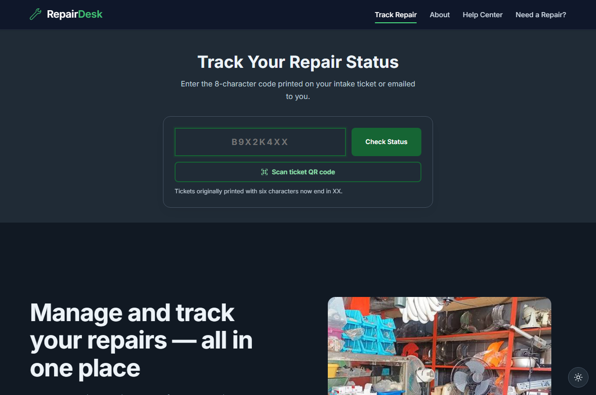
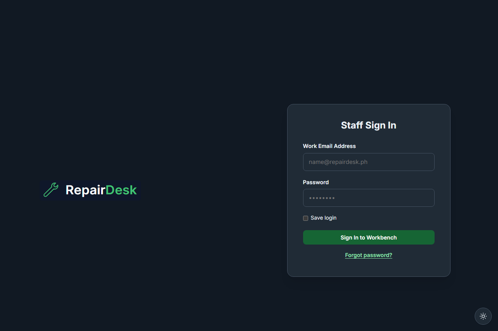

<h1 align="center">Centered Main Title</h1>

## Description

RepairDesk tracks electronics repairs from intake at the shop counter through collection and warranty. Customers use a ticket code and email verification to check their repair. Staff sign in to a PHP-backed dashboard. MySQL or MariaDB stores the repair records.

## Features

- **Customers** enter an eight-character ticket code or scan a QR sticker on the [tracking page](index.html). After email verification, they can see the appliance photo, customer-visible notes and itemized quote, approve or decline the quote, and check the warranty after collection.
- **Administrators** create jobs, attach an optional appliance photo, assign technicians, record payments and pickup, and manage shop contact details and public openings.
- **Technicians** work on assigned jobs, add progress notes, revise parts and labor charges, and update repair status. The [staff sign-in page](pages/login.html) also supports password recovery.

## Technologies

HTML, CSS and JavaScript power the interface. The browser uses the Fetch API and local QR libraries. The server uses PHP, PDO MySQL and PHPMailer with MySQL or MariaDB.

## Installation instructions

1. Place the project in `C:\xampp\htdocs\RepairDesk` and start Apache and MySQL in XAMPP. Use PHP 8.1 or newer with PDO MySQL enabled.
2. In the project root, run `composer install` to install PHPMailer from [composer.lock](composer.lock). The browser uses plain JavaScript and the QR scripts in `js/vendor/`. There is no frontend build step.
3. Complete the database setup below to create the tables and first administrator.
4. For a new installation, copy [api/config.example.php](api/config.example.php) to `api/config.php`. Set the database host, name, username and password. Set `tracking_url` to the customer-facing site address and fill in the SMTP settings for verification codes, repair emails and password resets.
5. Open [the local tracker](http://localhost/RepairDesk/) or [staff sign-in](http://localhost/RepairDesk/pages/login.html). For phone camera scanning, serve the site over HTTPS at an address the phone can reach.

## Database setup

1. In phpMyAdmin, create an empty database named `repairdesk` using the `utf8mb4_general_ci` collation. Select the database, open **Import**, and choose [database/schema.sql](database/schema.sql).
2. Generate a password hash for the first administrator. In PowerShell 7.1 or later, run the following and enter a new password of at least eight characters.

   ```powershell
   Read-Host 'New administrator password' -MaskInput | C:\xampp\php\php.exe -r 'echo password_hash(rtrim(fgets(STDIN), chr(13).chr(10)), PASSWORD_DEFAULT), PHP_EOL;'
   ```

3. In phpMyAdmin, open the `users` table and select **Insert**. Enter your name, email and the generated hash in `name`, `email` and `password_hash`. Choose `admin` for `role`, leave `active` set to `1`, and save. Sign in and add a technician before assigning the first repair.

## Screenshots

### Customer repair tracker



### Staff sign-in



## Live demo

- [Customer repair tracker](https://repairdesk.gt.tc/)
- [Staff portal](https://work-repairdesk.gt.tc/)

## Developers

| Developer | Contribution |
| --- | --- |
| Allesar Leomar Morden | RepairDesk project creator |

## Project layout

| Path | Purpose |
| --- | --- |
| `index.html`, `pages/` | Customer tracker, shop information, service fees, help, open roles and staff sign-in |
| `dashboard/` | Jobs, repair details, technician roster, customers, reports and settings |
| `api/` | PHP endpoints, database access, authentication and email delivery |
| `js/`, `css/` | Browser interactions, shared styles and themes |
| `js/vendor/` | Browser-ready QR scanner, worker, license and sticker generator served with the site |
| `assets/`, `components/` | Site images and shared interface markup |

## What belongs in Git

Commit the application source, site images, `js/vendor/`, `composer.json`, `composer.lock` and `api/config.example.php`. Keep schema migrations and sanitized structure-only SQL under version control when available.

Keep the real `api/config.php`, local environment files, Composer’s root `vendor/` directory and database backups out of Git. A full export can contain customer details, appliance photos and password hashes. Keep backups outside the web root. The ignore rules also cover a root-level `repairdesk.sql` and local `backups/` and `exports/` folders if they are copied into the project.
